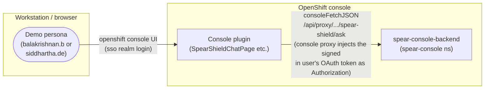
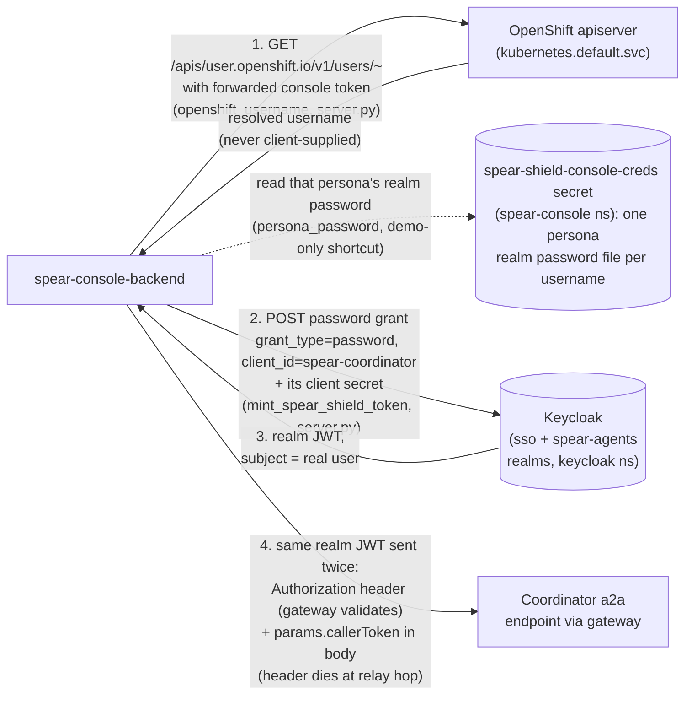
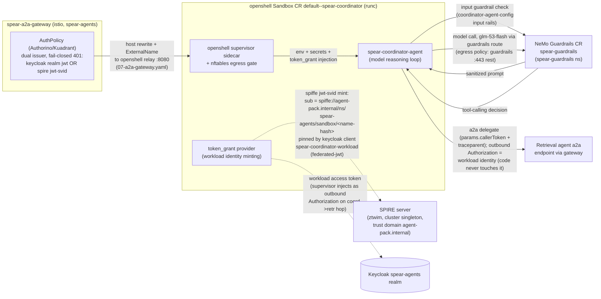
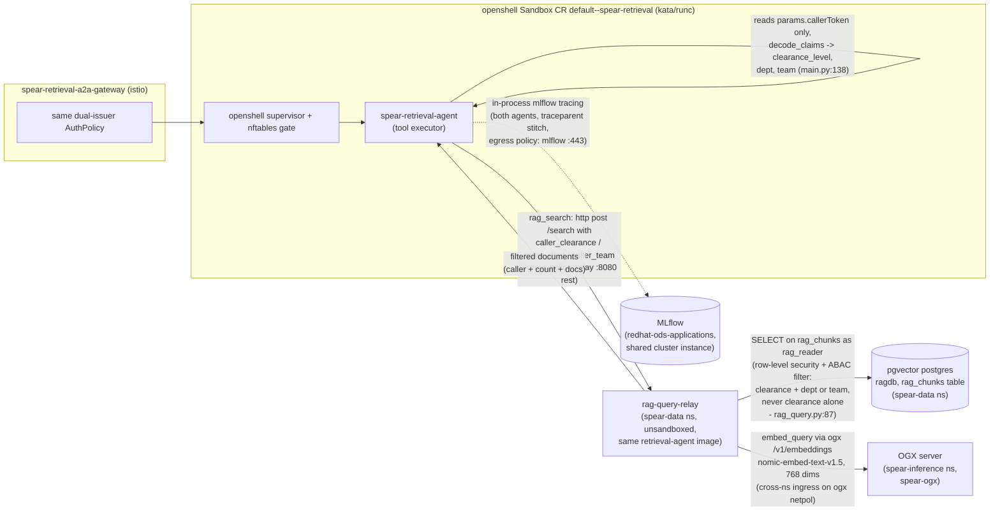
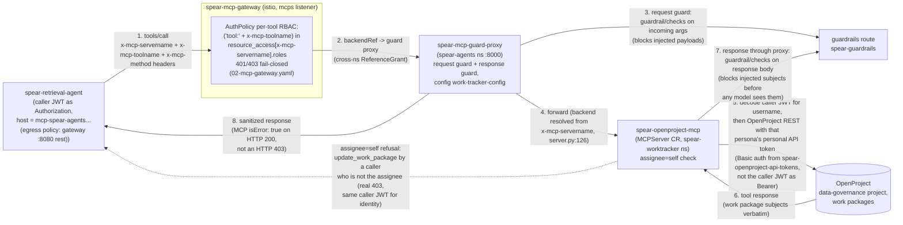
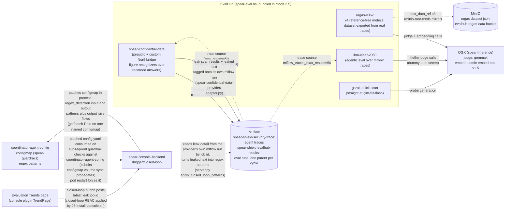

# SPEAR - End-to-End Flow Diagram

One question ("show my work packages" / "summarize the retention policy") traverses six
enforcement layers: sandbox isolation (runc / Kata), openshell egress policy, guardrails
(input, response, per-config), gateway auth (dual-issuer JWT), per-tool RBAC, and ABAC
row filtering. Split into five segments so each stays readable:

- [1. Ingress and identity minting](#1-ingress-and-identity-minting)
- [2. Coordinator agent sandbox (runc)](#2-coordinator-agent-sandbox-runc)
- [3. Retrieval agent sandbox (Kata) and the RAG data path](#3-retrieval-agent-sandbox-kata-and-the-rag-data-path)
- [4. Work-tracker MCP path with guardrails on every tool call](#4-work-tracker-mcp-path-with-guardrails-on-every-tool-call)
- [5. Evaluation loop and observability backplane](#5-evaluation-loop-and-observability-backplane)

Notation: `-->` request/response flow, `-.->` credential or config provisioned at deploy
time (dotted = not a runtime request path). All labels cite the file that implements/handles the hop.

---

## 1. Ingress and identity minting

The only user-facing door is the OpenShift console dynamic plugin. No client-supplied
username anywhere: the console proxy injects the signed-in user's own OAuth token, and the
backend resolves identity by a live apiserver self-lookup (`users/~`), never by trusting a
client. Identity minting is then a Keycloak password grant against the spear-agents
realm keyed on that verified username - the backend holds each persona's realm password on
file (`01-chat-creds.yaml`), a demo-only shortcut (no sso<->spear-agents federation
exists).

Why the token rides twice: openshell's relay strips inbound `Authorization` headers on the
sandbox hop (deliberate anti-spoofing - a2a has no per-hop auth of its own). The gateway
validates the header copy; the coordinator's code reads the body copy.

---

## 2. Coordinator agent sandbox (runc)

Inside `spear-agents`, the coordinator runs in an openshell Sandbox CR
(`default--spear-coordinator`, runc - never Kata: its supervisor opens a CSI SPIFFE socket
a virtiofs mount inside a Kata guest cannot proxy). Three credentials converge here, then
the model loop runs with guardrails on the way in and the way out.

The coordinator's LLM call never goes to the inference server directly: it goes through
the guardrails service's real route (`coordinator-policy.yaml` egress: guardrails :443),
where `coordinator-agent-config`'s input and output rails run, and that service forwards to
the real model. The retrieval hop's outbound `Authorization` is spoken for by workload
identity (injected by the supervisor), so the user JWT travels as `params.callerToken`
again - read without a local signature check (documented trade; the signature is verified
at the next enforcement point, the gateway's per-tool RBAC).

---

## 3. Retrieval agent sandbox (Kata) and the RAG data path

The retrieval agent runs in Sandbox CR `default--spear-retrieval` (Kata when a kata-oc node
has `/dev/kvm`, runc fallback). It reads `params.callerToken` only (errors -32001 if
absent), decodes the caller's clearance/dept/team claims, and takes one of two paths per
tool call. RAG path here; work-tracker path in segment 4.

ABAC is three dimensional by design: a chunk is visible only when its `clearance_level`
ranks at or below the caller and either the caller's `dept` or `team` matches (or the
chunk is `enterprise-wide`). `clearance_level` alone would wrongly grant cross dept
visibility. The relay connects as `rag_reader` (not the `raguser` superuser, which has BYPASSRLS and would
silently ignore the row-level security policy).

---

## 4. Work-tracker MCP path with guardrails on every tool call

For `search_work_packages` / `update_work_package`, the retrieval agent calls the MCP
gateway with the caller's real JWT as `Authorization` (its signature is finally verified
here by the per-tool RBAC AuthPolicy), then every request AND response is railed by the
guard proxy before any model or agent sees content.

The guard proxy is one deployment for every MCP server (no per-server env), deriving each
request's real backend from `x-mcp-servername` — onboarding a new MCP server is a one-line
HTTPRoute backendRef change. Demo: `scripts/demo-tool-response-injection.sh` plants a
real malicious work package; the response guard blocks its subject line before the
retrieval agent's LLM ever sees it. The caller JWT authorizes the MCP gateway hop and
supplies the username for assignee=self; OpenProject itself is called with that user's
personal API token from `spear-openproject-api-tokens`.

---

## 5. Evaluation loop and observability backplane

Phase 3's evaluation layer (installed/submitted manually - `10-install-evalhub.sh`,
`11-submit-evalhub-jobs.sh`). Four providers score the same agent; results land in MLflow
under one parent cycle run, and the closed loop feeds the leak scanner's findings back
into guardrails config. Dotted = deploy-time or offline; solid = runtime path.

No LLM judge for the closed loop: the backend reads the leak detail from the scanner's
own mlflow run (tagged there by the provider's adapter), converts the leaked text into
regex patterns (plus the scanner's own canonical rebate/volume patterns), and patches
`coordinator-agent-config` input and output `regex_detection` in process, enabling
output rails if missing. Output is what blocks a re ask of the same natural question;
input alone only matches if the figures appear in the user prompt.

---

## Segment index

| Segment | Hops | Enforcement shown |
|---|---|---|
| 1 | console -> plugin -> backend -> apiserver -> keycloak | apiserver self-lookup identity, password grant (demo-only persona password on file) |
| 2 | gateway -> sandbox -> guardrails -> retrieval | dual-issuer auth, spiffe sub pinning, input rails, sandbox egress |
| 3 | retrieval -> relay -> ogx/pgvector | ABAC (clearance + dept or team), RLS via rag_reader, trace export |
| 4 | retrieval -> gateway -> guard proxy -> openproject | per-tool RBAC, request + response guardrails, assignee=self |
| 5 | evalhub providers -> ogx/mlflow/minio, closed loop | eval cycle, leak scan -> guardrail patch |

Refer [README.md](README.md) for further details on build/deploy chain, pipeline ingestion + AutoRAG, platform operators layer, the openshell external CLI route.
